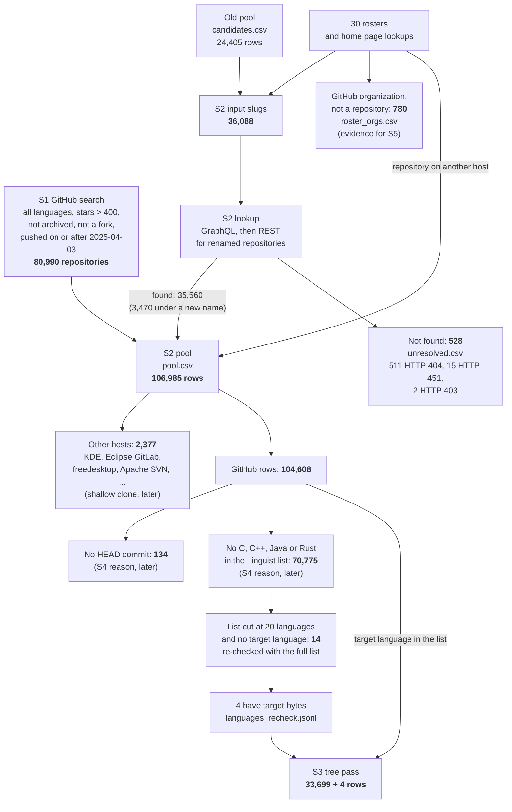
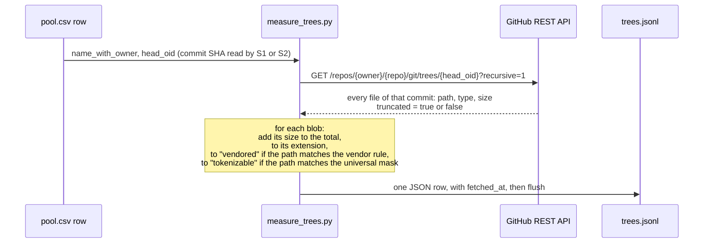

# Stage S3: how each repository is measured

This document explains the S3 tree pass: which pool rows it measures, how it
pins each measurement to one commit, what it counts, and how the run can be
checked and repeated. The sources of each input are in `SOURCES.md`. The plan
is `../DATASET-RESOURCING-PLAN.md`.

Status on 2026-10-06 03:30 UTC: the pass runs; 9,457 of 33,699 rows are done.

## 1. From the sources to the measured rows

Each box gives the count on 2026-10-06. No step drops a row without a record.



The search and the looked-up slugs overlap. `build_pool.py` merges them by the
GitHub `databaseId`, so a repository that comes from several sources is one
row. The column `origins` lists all its sources.

## 2. The choice of rows: a pre-filter, not the measurement

The column `languages` of `pool.csv` holds the Linguist byte counts that
GitHub computes for each repository. S1 and S2 read them with the GraphQL field
`languages(first: 20, orderBy: {field: SIZE, direction: DESC})`.

A GitHub row goes to the tree pass if all three conditions are true:

1. it has a HEAD commit (`head_oid`);
2. its language list contains C, C++, Java or Rust, or
   `languages_recheck.jsonl` finds target bytes for it;
3. its host is `github.com`.

Linguist does not count vendored, generated or documentation files. So this
step only removes the repositories that have no target code at all. The
exact share comes from the tree pass.

**The cut at 20 languages.** The list holds only the 20 largest languages.
1,059 rows list 20 languages. 14 of them list no target language, so a target
language can be below the cut. `recheck_languages.py` reads the full list
(`first: 100`) for these 14 rows. 4 of them have target bytes (103 to 4,052
bytes): `aiskillstore/marketplace`, `radian-software/apheleia`,
`oxsecurity/megalinter`, `openreplay/openreplay`. They are measured like all
other rows.

## 3. One repository, step by step



**Why the commit is fixed.** S1 and S2 recorded `defaultBranchRef.target.oid`:
the SHA of the commit at the HEAD of the default branch when the row was
fetched. The tree call names that SHA, not `HEAD`. A commit cannot change, so
the same call gives the same tree on a later day. A push to the repository
after the fetch does not change the measurement.

Limits:

- The commits are not from one moment. They were read between 2026-10-05
  20:47 and 2026-10-06 02:03 UTC. Each pool row records its own `fetched_at`.
- If an owner force-pushes and GitHub deletes the old commit, the call fails.
  The row then records the HTTP status and has no counts.
- GitHub truncates a tree with more than 100,000 entries or more than 7 MB.
  The row then has `truncated: true`, and its counts cover only part of the
  tree. For such a row, the Linguist bytes are the fallback.

**What one row of `trees.jsonl` holds.**

| Field | Meaning |
| --- | --- |
| `name_with_owner`, `head_oid`, `tree_sha` | the repository, the measured commit and its root tree |
| `status` | the HTTP status of the tree call |
| `truncated` | true if GitHub cut the tree |
| `total_bytes`, `n_blobs` | all files of the commit |
| `by_ext` | bytes for each file extension |
| `vendor_by_ext` | bytes for each extension, only in vendored paths (`vendor/`, `third_party/`, `external/`, `deps/`, ...) |
| `tok_bytes`, `n_tok` | the files that the universal mask selects: the files that cregit can tokenize |
| `tok_vendor_bytes` | the part of `tok_bytes` in vendored paths |
| `fetched_at` | the time of the call (UTC) |

**From these counts to the share rule (stage S4).** The code bytes are the
bytes of the extensions that Linguist gives only to languages of type
`programming` (`prog_exts.py`, Linguist commit `538da05f`), plus the mask
extensions. S4 computes them from `by_ext`. The rule is: `tok_bytes` is at
least 5% of the code bytes.

## 4. The mask and its version

The script imports `UNIVERSAL_MASK` from
`$CREGIT_PROJECTS/cregit-token-pipeline/file_mask.py`, the same mask that the
pipeline uses. At start, `run.log` records:

- the SHA-256 of the mask string: `665c23c0…`;
- the last commit that changed `file_mask.py`: `91d6ccab`.

Before the start, the file had no uncommitted change and was the same as in
`91d6ccab`. The script reads the mask once, at start. An edit to the file
during the run does not change the run, and the log does not show the edit.

## 5. Quota, stops and the resume

- GitHub allows 5,000 REST calls per hour. When the quota is used up, the
  script sleeps until the reset, and `run.log` says so.
- After a server error (HTTP 500, 502, 503, 504) or a network error, the
  script waits 30 seconds and tries again, up to 10 times.
- An HTTP 403 with quota left and no `Retry-After` header is the status of the
  repository (for example, GitHub blocks it). The script records it and does
  not try again.
- The script writes each row and flushes it at once. At start, it skips the
  rows that are already in `trees.jsonl`. So after a stop, run it again:

```sh
cd dataset-selection/s3-measure
python3 measure_trees.py
```

The 4 rows of `languages_recheck.jsonl` were found after the start. The next
run of `measure_trees.py` measures them.

## 6. How to check the result

When the pass ends:

1. `wc -l trees.jsonl` gives 33,703 (33,699 + 4).
2. Count the rows by `status`. Each row that is not 200 needs its reason in S4.
3. Count the rows with `truncated: true`. Each one uses the Linguist fallback.
4. Compress the file to `trees.jsonl.xz`, write its SHA-256, and commit both.

To repeat one measurement, call the tree API with the `head_oid` of the row.
The result is the same, if GitHub still has the commit.

## 7. What S3 does not do yet

- The 2,377 rows on other hosts are measured later, by a shallow clone at the
  snapshot date.
- The commit counts are read later, only for the rows that pass the share
  rule.
- Stage S4 is not written yet. It gives each row that leaves a reason in
  `excluded_because`: "no HEAD commit", "no C, C++, Java or Rust bytes in
  Linguist", the HTTP status of a failed tree call, or the share rule.
