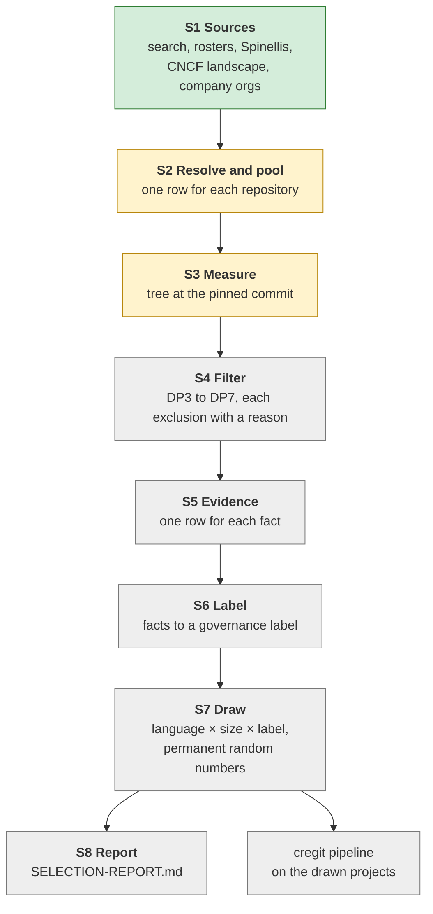

# Projects dataset: the selection, stage by stage

This document gives a view of all stages of the selection, from the sources to
the drawn projects: what each stage reads, what it does, what it writes, its
status and its counts. The plan with all rules is
`../DATASET-RESOURCING-PLAN.md`. The source of each input is in `SOURCES.md`.
The tree measurement (S3) has its own detailed document, `S3-MEASUREMENT.md`.

Status: 2026-10-08 13:35 UTC (S1–S4 done; frame 25,263 projects in `s4-filter/frame.csv`; census batch 1 of 164 projects running since 2026-10-07 with `--latest --tokenizer-worker`, 21 done; run files indexed in `s7-run/README.md`). Snapshot date: **2026-10-05**.

## 1. Rules for every stage

1. A label claims only what its evidence shows. Each fact stores its source and
   its fetch date.
2. No residual label. A project with no evidence is `unknown`, never
   `community` by default.
3. Every exclusion has a recorded reason (`excluded_because`).
4. Every hand decision is a row in a reviewed file, with a reason and a source.
5. One date fixes the frame: all age tests use the snapshot date.
6. One flow diagram counts every step, from the sources to the drawn projects.
7. Each stage writes its own files. A later stage reads only earlier files.
   Every fetched file is kept with its exact bytes.

## 2. The stages

Green: done. Yellow: running. Grey: not started.

| Stage | Reads | Writes | Status |
| --- | --- | --- | --- |
| S1 Sources | the sources below, each with a fetch date | `s1-search/`, `rosters/`, `sources/` | done, except the company org listing (running) |
| S2 Resolve and pool | S1 files | `s2-pool/pool.csv`, `unresolved.csv`, `roster_orgs.csv` | running again with the new inputs |
| S3 Measure | `pool.csv`, GitHub REST | `s3-measure/trees.jsonl` | 9,457 rows done; restarts after S2 |
| S4 Filter | S3 output | `frame.csv` with `included` and `excluded_because` | not started |
| S5 Evidence | frame, rosters, company pages, org profiles | `evidence.csv` | company pages are being fetched |
| S6 Label | `evidence.csv` | `labels.csv` with `label_basis` | not started |
| S7 Draw | frame and labels | `manifest.sample.tsv` | not started |
| S8 Report | all of the above | `SELECTION-REPORT.md` | not started |

## 3. S1: sources

Each source enters the pool with its own stated criteria. There is no "old
pool": the earlier `candidates.csv` is not an input (decided 2026-10-06).

| Source | Criteria | Rows | Fetched | Role |
| --- | --- | ---: | --- | --- |
| GitHub search | all languages, stars > 400, not archived, not a fork, pushed on or after 2025-04-03 | 80,990 repositories | 2026-10-05/06 | pool only |
| 30 foundation and sponsor rosters | each organization's own published list | see `SOURCES.md` | 2026-10-05 | pool and `roster` evidence |
| GNU package pages | the 53 packages with no Savannah repository; curl copies, browser copies only behind a bot check | 53 pages | 2026-10-06 | GNU roster |
| Spinellis et al., MSR 2020 | their enterprise set (3 e-mail domain heuristics), no stars rule | 17,264 projects | Zenodo 3742962, 2026-10-06, MD5 verified | pool, and the company list |
| CNCF landscape | every entry with a repository; only `project:` entries are CNCF-hosted | 1,059 repositories (293 hosted) | 2026-10-05 copy | pool only |
| Company orgs | every public repository of each kept company org (rules below) | 506 orgs, 81,425 public repositories | 2026-10-06, running | pool only |
| GitLab instances and roster groups | every public, non-fork project in a group namespace of the 11 GitLab hosts in our data (git.adelielinux.org, git.dynare.org, git.themanaworld.org, gitlab.archlinux.org, gitlab.eclipse.org, gitlab.freedesktop.org, gitlab.gnome.org, gitlab.inria.fr, gitlab.winehq.org, invent.kde.org) and of the 22 gitlab.com groups that roster rows name; not archived, last activity on or after 2025-04-03, C, C++, Java or Rust in the languages API; no stars rule (like the rosters) | 31,148 listed, 2,729 kept | 2026-10-13/14 | pool supplement, batch 25 (`s2-pool/gitlab/`) |
| gitlab.com search | public, not archived, stars > 400 (the GitHub search rule), last activity on or after 2025-04-03, not a fork, C, C++, Java or Rust in the languages API; group and personal namespaces (no owner rule, as the GitHub search; personal namespaces since 2026-10-14 ~15:35 UTC) | 75 listed, 38 kept (28 group, 10 personal) | 2026-10-14 | pool supplement, batch 25 (`s2-pool/gitlab/`); the personal rows add 1 project, muttmua/mutt, as batch 26 (a DP8L v4 near miss, since 2026-10-14 ~16:40 UTC) |

**Why GitLab adds few rows.** Few gitlab.com projects have more than 400 stars (75, against 80,990 on GitHub); v1 takes only layer 1; many large GitLab projects are already in v1 through GitHub copies (GNOME 53, KDE 58 rows); the license rule removed mutt until the DP8L v4 near misses also passed GitLab rows (batch 26). Details: `s2-pool/gitlab/README.md`, section "Why the GitLab extension adds few projects".

**GitLab rows (2026-10-14).** Their snapshot is later than that of the other rows: the pinned commit is the head of the default branch fetched on 2026-10-14 (`s2-pool/gitlab/measure.jsonl`), not 2026-10-05. A GitLab row that shares its history with a pool row of the same project is not added; copies (mirror, backup, backport and CI namespaces, the Qt mirrors on invent.kde.org) and forks are removed; an upstream whose root commit is shared only with its forks is kept (`s2-pool/gitlab/decide.py`, rules R1-R5). 50 rows pass DP3 and DP8L and enter version 1 as batch 25. Since 2026-10-14 ~16:40 UTC the DP8L v4 near misses C, D and E also pass GitLab rows (`s2-pool/gitlab/near_miss_gitlab.py`): muttmua/mutt (class C: root `COPYRIGHT`, `GPL`) enters version 1 as batch 26; mesa/demos (class H: no license evidence) stays out.

**Sources that were dropped, with the reason:**

- The old GitHub search (top 260 by stars for each of 4 languages): all 100 rows
  that only it gave fail DP5 or DP6, so our search gives the same final dataset.
- The Spinellis cohort (311,223 projects): it is a comparison set, not a company
  signal.
- The old community seed and the old company org list: hand lists with no cited
  source for each entry.

**Company list (from Spinellis et al.).** A company is a company name on a
Spinellis row with a Fortune Global 500, SEC 10-K or SEC 20-F flag: 166
companies. A GitHub owner is a company org only if three rules pass:

| Rule | Test | Owners that fail |
| --- | --- | ---: |
| L1 | the owner is linked to one company only | 10 (apache, kubernetes, openstack, ...) |
| L2 | the company is on more than half of the owner's rows | 11 (eclipse, onnx, spring-cloud, ...) |
| L3 | at the snapshot, the owner is a GitHub Organization | 124 (107 User accounts, 18 gone) |

Result: 506 org links kept, for 150 companies. Known limit: the list misses
companies with no Fortune or SEC flag (for example JetBrains), and orgs whose
rows carry no company (for example linkedin).

## 4. S2: resolve and pool

- Each slug from the rosters, Spinellis and the landscape is looked up with
  GitHub GraphQL. GraphQL does not follow a rename, so a slug that it does not
  find is checked with REST, which follows the redirect.
- `build_pool.py` merges all rows by the GitHub `databaseId`. Repositories on
  other hosts (KDE, Eclipse GitLab, freedesktop, Apache SVN, ...) are merged by
  their normalized URL. The column `origins` lists every source of a row.
- No row is dropped. A slug that neither lookup finds goes to `unresolved.csv`
  with its HTTP status. A roster row that names a GitHub organization, not a
  repository, goes to `roster_orgs.csv` (the `roster_org` fact for S5).
- A roster row that names an organization, a group or a site, not one
  repository, is never expanded into repositories, on GitHub or on any other host.
  In S4 it leaves with the reason "roster names an organization" or "roster
  names a site or a group".

The first pool (with `candidates.csv`) had 106,985 rows. The pool is being
rebuilt with the new inputs; the counts follow when it ends.

## 5. S3: measure

Only GitHub rows whose Linguist languages include C, C++, Java or Rust are
measured; the others leave in S4 with that reason. For each row, one REST call
reads the recursive tree **at the HEAD commit that S1 or S2 recorded**, so a
later push does not change the result. The pass counts, for each file: its
size, its extension, whether the path is vendored, and whether the universal
mask (`file_mask.py`, commit `91d6ccab`) selects it.

The Linguist list holds only the 20 largest languages. 14 rows that reach this
cut showed no target language; `recheck_languages.py` read their full list, and
4 of them have target bytes, so they are measured too.

Details, limits and checks: `S3-MEASUREMENT.md`.

## 6. S4: filters

| DP | Rule |
| --- | --- |
| DP3 | tokenizable bytes that are not vendored ≥ **5%** of code bytes at the measured commit (decided 2026-10-06: vendored code does not count). Code bytes: the extensions that Linguist (`languages.yml`, commit `538da05f`) gives only to languages of type `programming`, plus the tokenizable extensions. |
| DP4 | none (the old `size_kb` rule is dropped) |
| DP5 | last push on or after 2025-04-03 (550 days before the snapshot) |
| DP6 | not archived, not a GitHub fork, not a mirror (GitHub `isMirror`) |
| DP7 | the commit count at the pinned commit (GitHub GraphQL `history.totalCount`, or `git rev-list --count` for other hosts); it sets the run layer, it removes no row |
| DP8L | the project has a license file at the snapshot commit, read from the root tree with the same rule for all hosts (`git ls-tree`, or the GitHub git trees API): a root file whose name is `LICENSE`, `LICENCE`, `LICENSES`, `UNLICENSE` or `COPYING`, alone or followed by `.`, `-`, `_`, a space or a digit (case-insensitive; for example `LICENSE.txt`, `LICENSE-MIT`, `COPYING3`), or a root folder named `LICENSES`, `LICENCES`, `LICENSE` or `LICENCE` that holds at least one file (REUSE); **or**, for GitHub rows, GitHub detects a license (`licenseInfo`, column `license` not empty: an SPDX id or `NOASSERTION`). A row passes if one of the two tests passes. The rows that fail both keep their near-miss reason in `excluded_because` (`s4-filter/dp8l-audit/method.md`) |

Each row that leaves gets one or more reasons in `excluded_because`, also the
rows with no target language and the rows with no HEAD commit.

## 7. S5 and S6: evidence and labels

**Facts (S5).** One row for each fact, with its source and date:

| Fact | Source |
| --- | --- |
| `roster:<foundation>` | the foundation's list names the repository |
| `roster_org:<foundation>` | the repository is in an org or group that the list names |
| `fiscal_sponsor:<sfc, spi, numfocus or psf-sponsored>` | the SFC or SPI member list, a NumFOCUS "sponsored" project (numfocus.org/sponsored-projects), or a PSF fiscal sponsoree (python.org/psf/fiscal-sponsorees); each roster file has `org_kind` `fiscal-sponsor` |
| `roster_affiliated:numfocus` | a NumFOCUS "affiliated" project; NumFOCUS does not fiscally sponsor these, so the fact sets no label |
| `government:<body>` | a cited list of government orgs |
| `owner_kind:user` or `owner_kind:org` | GitHub API |
| `company_pool:spinellis` | the project is in the Spinellis enterprise set, with a company |
| `company_org:<org>` | a kept company org, with a company page (strong) or a GitHub verified org with its website on the company domain (supporting) |
| `company_org_candidate:<org>` | a kept company org with neither; it sets no label |
| `company_roster:mozilla` | the Mozilla org listing (`rosters/mozilla.csv`, org_kind company) names the repository |
| `company_roster_org:redhat` | the Red Hat "All projects" table (redhatofficial.github.io) names the GitHub org of the repository. The table says that Red Hat takes part in the project; it does not state control. It counts as a company fact by the decision of 2026-10-09 |

**Company pages.** For each kept org, the website that the org publishes in its
GitHub profile is fetched with curl, one at a time, if it is on a company
domain. No URL is guessed. An org has a company page only if that page links
to `github.com/<org>`: 35 orgs from curl, and 5 more from the browser reads of
the 30 websites that blocked curl, 40 in total. Of the 506 kept
orgs, 85 are GitHub verified and 197 have a website on a company domain.

**Labels (S6).**

| Label | Rule |
| --- | --- |
| `foundation` | a `roster` or `roster_org` fact |
| `company` | a company fact (`company_pool:spinellis`, `company_org`, `company_roster` or `company_roster_org`), and no `roster` fact; `label_basis` names each fact |
| `contested` | a `roster` or `roster_org` fact and a company fact together (also a `fiscal_sponsor` fact and a company fact) |
| `government` | a `government` fact |
| `fiscal-sponsor` | a `fiscal_sponsor` fact (SFC, SPI, NumFOCUS "sponsored", PSF fiscal sponsoree), and no `roster` fact |
| `personal` | `owner_kind:user`, and no other fact |
| `community` | positive evidence only (a governance document) |
| `unknown` | no fact |

## 8. S7: draw

1. **Cells:** language × size × label. Every label is its own cell, `unknown`
   and `personal` included.
2. **Allocation:** at least 2 projects for each cell, then proportional by
   largest remainder.
3. **Order:** each repository gets the number `sha256("20261110:" + slug)`.
   Each cell takes its rows with the lowest numbers. A later change to the
   frame changes only the rows near the edge of a cell.
4. **No cap for each governor** (decided 2026-10-06). The report gives the
   concentration for each company and foundation. Example from the frame:
   4 companies (Microsoft, Amazon, Alphabet, Adobe) own 50% of the 45,306 live
   public repositories of the kept company orgs.
5. Each drawn project keeps the HEAD commit of the snapshot. The pipeline
   clones that commit, so a re-run reads the same code.

## 9. S8 and the pipeline

`SELECTION-REPORT.md` gives the flow diagram with the count of every step and
every decision point with its counts. It becomes the selection section of the
paper. The drawn projects then run through the cregit pipeline with the srcML
build of cregit `master` (develop `d382719`, which has both attribute fixes).

## 10. Decisions

| Date | Decision |
| --- | --- |
| 2026-10-05 | tokenizable bytes ≥ 5% of code bytes; no `size_kb` rule; strata language × size × label; all languages in the search; own labels for fiscal sponsors and government |
| 2026-10-05 | Red Hat: a pool source with company evidence; GNU pages through the browser where needed |
| 2026-10-06 | no "old pool": each source is fetched by us with stated criteria |
| 2026-10-06 | Spinellis enterprise set with no stars rule; cohort not used |
| 2026-10-06 | company list from a published list (Spinellis), org link rules L1 to L3 |
| 2026-10-06 | old GitHub search dropped (backed by the data); CNCF landscape kept as a pool source |
| 2026-10-06 | every public repository of the kept company orgs enters the pool |
| 2026-10-06 | company pages: curl first, the browser only behind a bot check |
| 2026-10-06 | no cap for each governor in the draw |
| 2026-10-06 | Spinellis labels stay tracked: `company_pool:spinellis` is a company fact in S5, and `label_basis` in S6 names it. The report counts the company labels that rest on this fact alone. |
| 2026-10-06 | the goal is every project of the frame; the permanent random numbers set the run order, so the projects done at any date are a random sample |
| 2026-10-06 | no filter on the length of the history; a filter on distinct authors is to be measured; the commit-count threshold is to be set from the data (100 is too low) |
| 2026-10-06 | the run order by permanent random numbers is accepted; cregit-token-pipeline must do each project end to end (clone at the pinned commit, tokenize, Parquet, join, clean) and keep an audit record of each step |
| 2026-10-06 | the code rule stays the share of tokenizable code (DP3, 5%); no minimum amount of tokenizable code; the author count waits until all sourcing ends |
| 2026-10-06 | company pages: no guessed URLs; only the website that each org publishes in its GitHub profile |
| 2026-10-06 | filters added: DP3 counts only code that is not vendored; DP6 also removes mirrors; DP8L requires a license file of any kind |
| 2026-10-06 | run layers by commit count, largest first: ≥ 5,000, 1,000–4,999, 500–999, 100–499, < 100; within a layer the order is u, so a finished layer is complete and an unfinished layer is a random sample of its layer |
| 2026-10-06 | the pipeline writes no HTML (`--skip-html`) |
| 2026-10-06 | anonymization is a separate release step over the whole dataset, with its own audit record; the pipeline keeps the raw Parquet |
| 2026-10-09 | the Parquet columns `license`, `owner_type`, `archived`, `fork` must be filled before the release: batches 6–20 get enriched sidecars (`s7-run/enrich_meta.py`), batches 1–5 get `s7-run/rewrite_meta_columns.py` after the merge |
| 2026-10-06 | shared history: keep all copies; the clusters of repositories with the same root commit are recorded as a fact only |
| 2026-10-07 | the run uses the newest commit: each project runs at the head of its default branch when its first census attempt starts (`ctp.py census --latest`). The selection facts (S3, S4) stay measured at the snapshot commit; the manifest keeps that commit, and the ledger records both (`pinned_sha` ran, `snapshot_sha` from the manifest). Batch 1 projects 1–4 (reyamira/models, libgit2/libgit2, devflowinc/trieve, mongodb/libmongosql) ran at the snapshot commit before this decision, so they run again at the newest commit (user, 2026-10-07): the 3 finished outputs moved to `census-2026-10/.superseded/20261007/` (recorded in `s7-run/superseded-20261007.tsv`: old commit, Parquet sha256, rows, run id), and the mongodb and Linux runs were stopped before they ended. A first plan, a head override for Linux alone (602042bf, read 2026-10-07 00:46:58 UTC), was dropped for this rule before it was used |
| 2026-10-09 | version 1 of the dataset = **every project of run layer 1** (≥ 5,000 commits at the snapshot commit; 3,265 projects of the frame). Layer 1 is then complete, not a sample: the dataset is all active, licensed C, C++, Java and Rust projects of the pool with at least 5,000 commits. Layers 2–5 are for a later version. Batch 1 is retokenized with cregit 95cdc88 so that version 1 uses one srcML build (user, 2026-10-09) |
| 2026-10-09 | S5 and S6 for layer 1 (`s5-evidence/`, `s6-labels/`), decided by the user: (1) a kept company org with no company page and no verified domain on the company's domains is a candidate only (`company_org_candidate`, no label); (2) `government` facts and governance documents are not collected for version 1, so `government` and `community` are 0 because the evidence was not collected; (3) NumFOCUS "sponsored" projects and PSF fiscal sponsorees give `fiscal_sponsor` (their roster files have `org_kind` `fiscal-sponsor`), NumFOCUS "affiliated" sets no label |
| 2026-10-09 | the Red Hat "All projects" table (`company_roster_org:redhat`) is a company fact: it gives `company` with no roster fact and `contested` with a `roster` or `roster_org` fact. The table says only that Red Hat takes part in the project; the user chose to count it. It changed 61 layer 1 labels (34 `unknown` to `company`, 26 `foundation` to `contested`, systemd `fiscal-sponsor` to `contested`) |
| 2026-10-10 | roster organizations, groups and sites are not expanded on any host (the rule was written for GitHub only). The 3 LF organizations with no `https://` in the roster URL and the 9 GitLab groups keep their S4 reason; no repository of theirs is added (user, 2026-10-10) |
| 2026-10-10 | DP8L = the root rule for all hosts (section 6; `s4-filter/dp8l_rule.py`) **or** a license that GitHub detects. The user chose the union so that no row of the frame leaves: 154 GitHub rows of `frame.csv` (40 in layer 1) pass only by GitHub's detection (for example a root `COPYRIGHT` or `MIT-LICENSE.txt`); `s4-filter/dp8l-audit/method.md` names them with their root names. With the union the v3 frame has 25,866 projects and layer 1 has 3,346 (`s4-filter/funnel.v3.md`). Before, GitHub rows passed only when GitHub's license detector knew the license, so S4 removed 2,692 GitHub rows without a check of their files; 602 of them have a root license file (58) or a root license folder (544), 80 in layer 1 (`s4-filter/dp8l-audit/`). The near misses (other root names, package files, subfolders, README, third-party folders only) stay out with their reason. The 80 layer 1 projects and BusyBox (`s4-filter/supplement.v2.csv`) join the census as batch 21, a supplement in u order, after batch 20; each row has its u batch (the batch of 164 rows of `frame.layer1.csv` whose u range holds it), so batches 1..k plus the batch 21 rows with u batch ≤ k are a u prefix of the corrected layer 1. NetBSD/pkgsrc (L) goes to the list batch21L. The `license` column of these rows comes from the files: the SPDX ids that name the files of the root folder `LICENSES`, else `NOASSERTION` (`s4-filter/dp8l-audit/licenses.csv` keeps the evidence path). frame.csv, frame.layer1.csv and the built batches do not change (user, 2026-10-10) |
| 2026-10-14 | GitLab extension (user, 2026-10-13 ~22:15 and 2026-10-14 ~01:00 UTC): the projects of the GitLab instances in our data and of the gitlab.com roster groups enter the pool with no stars rule (like the rosters); a gitlab.com-wide search uses stars > 400 (the GitHub search rule). The rule of 2026-10-10 "roster groups are not expanded" is replaced for GitLab ("Today's choice replaces it"). Copies: "Remove copies, keep upstreams" — skip a GitLab row only if the shared-history pool row is the same project; remove copy namespaces and forks; keep an upstream whose root is shared only with a fork (vkd3d). Release: "adding another batch is the way to go", into version 1 as batch 25 (50 projects). The instance owner is foundation evidence by the roster rule (`s7-run/labels_batch25.py`) |
| 2026-10-14 | the gitlab.com search also takes personal namespaces, the same rule as the GitHub search (user, ~15:35 UTC: "Yes then"). Of the 18 personal rows none enters v1 at first (8 no target language, 8 below 5,000 commits, OpenRGB the same project as a frame row, mutt fails DP8L; see the next row for mutt). The 73 GitLab rows removed as forks of a pool project stay out of v1; LIMITATIONS notes this difference against GitHub, where only the GitHub fork flag removes a row. The GitLab labels get a manual review later |
| 2026-10-14 | the DP8L v4 near-miss classes C, D and E (2026-10-11, GitHub rows only until now) also pass GitLab rows (user, ~16:40 UTC: "yes to mutt"). `s2-pool/gitlab/near_miss_gitlab.py` uses the classes of `s4-filter/dp8l-audit/audit_dp8l.py` on the 2 GitLab rows that fail only DP8L: muttmua/mutt is class C (root `COPYRIGHT`, `GPL`) and enters version 1 as batch 26 (1 row, license NOASSERTION); mesa/demos is class H and stays out. Version 1 = 3,548 projects. The license rule now has no difference against GitHub; the fork rule keeps its difference |
